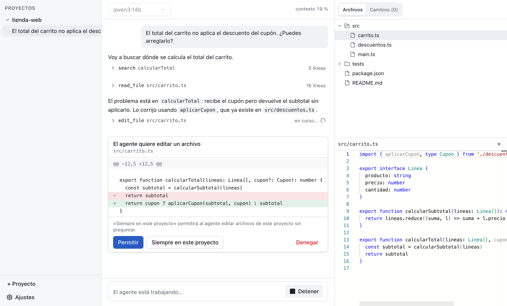
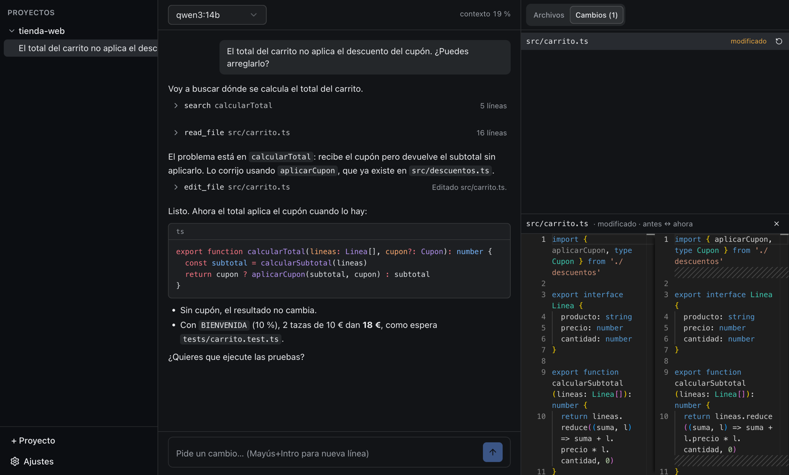
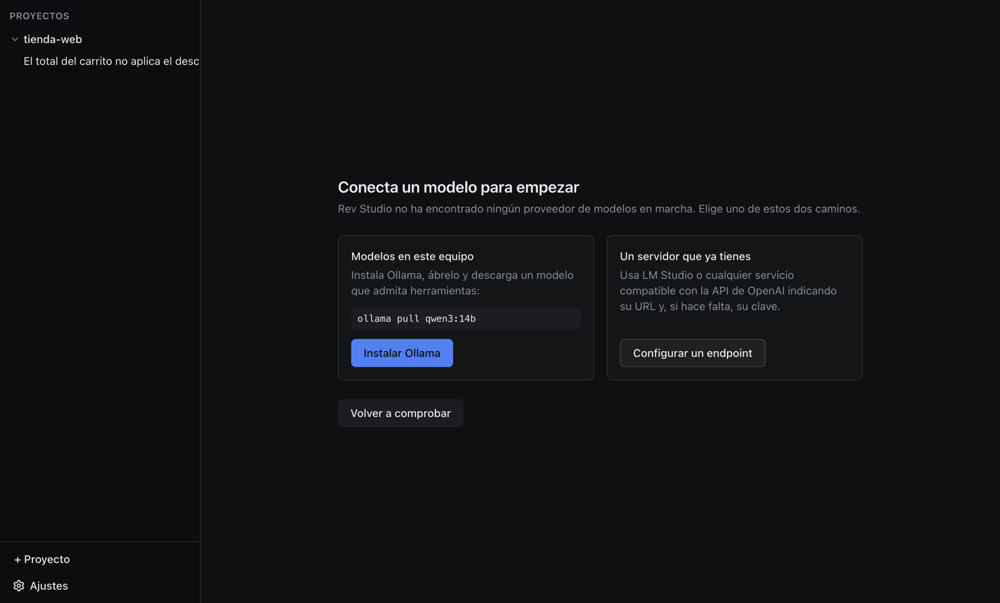

# Rev Studio

App de escritorio para programar con un agente de IA que usa **modelos abiertos en tu propio equipo**. El agente lee, busca y edita los archivos de una carpeta de proyecto y ejecuta comandos en ella. **Siempre te pide permiso** antes de cambiar un archivo o ejecutar algo.

Funciona con [Ollama](https://ollama.com), LM Studio o cualquier servidor compatible con la API de OpenAI. Disponible para macOS (Apple Silicon e Intel) y Windows.



## Qué hace

- **Trabaja en tu proyecto.** Lista carpetas, lee archivos, busca con ripgrep (respetando `.gitignore`), edita, crea archivos y ejecuta comandos en zsh (macOS) o PowerShell (Windows).
- **Nada cambia sin tu permiso.** Cada edición se muestra como un diff y cada comando completo antes de ejecutarse. Puedes **Permitir**, **Denegar** o elegir **Siempre en este proyecto**; la tarjeta te dice exactamente qué regla se guardará.
- **Todo se puede deshacer.** Antes de tocar un archivo se guarda una instantánea. La pestaña **Cambios** muestra el diff de cada archivo modificado en la sesión y lo **revierte** con un clic.
- **Editor integrado.** Árbol del proyecto que se actualiza solo, editor Monaco con guardado (Cmd/Ctrl+S) y aviso si el archivo cambia en disco.
- **Conversaciones largas.** Medidor de contexto y resumen automático de la conversación cuando se acerca al límite del modelo.
- **Tus datos en tu equipo.** Proyectos, sesiones y claves se guardan en local; las claves de API, cifradas con el llavero del sistema.



## Descargar e instalar

Descarga el instalador de tu equipo desde la página de **[versiones](https://github.com/revsystemscode/rev-studio/releases/latest)**:

| Equipo | Archivo |
| --- | --- |
| Mac con Apple Silicon (M1 o posterior) | `Rev-Studio-X.Y.Z-mac-arm64.dmg` |
| Mac con Intel | `Rev-Studio-X.Y.Z-mac-x64.dmg` |
| Windows 10/11 (64 bits) | `Rev-Studio-X.Y.Z-win-x64.exe` |

La app no está firmada con un certificado de Apple ni de Microsoft, así que la primera vez el sistema mostrará un aviso. La guía **[docs/INSTALAR.md](docs/INSTALAR.md)** explica paso a paso cómo abrirla, cómo instalar Ollama y qué modelo descargar.

**Requisitos:** 16 GB de RAM como mínimo para los modelos recomendados (por ejemplo `qwen3:14b`) y unos 10 GB libres para el modelo.



## Seguridad y permisos

- Las lecturas (listar, leer, buscar) no piden permiso. Las ediciones y los comandos, sí.
- Las herramientas de archivos no pueden salir de la carpeta del proyecto, ni siquiera a través de enlaces simbólicos.
- «Siempre en este proyecto» guarda una regla por proyecto, que puedes ver y borrar en **Ajustes**. Para comandos, la regla cubre las dos primeras palabras (por ejemplo `npm test`) y solo se aplica a comandos simples: nunca a comandos encadenados, con redirecciones o sustituciones. No se ofrece cuando permitiría mucho más de lo que has visto (como `rm -rf …` o `node -e …`).
- Los comandos se ejecutan con tus permisos de usuario: revisa cada uno antes de aprobarlo.

## Desarrollo

Requisitos: Node.js 22.13 o posterior (el CI usa Node 24) y pnpm 11.

```sh
pnpm install
pnpm --filter @rev/desktop dev      # abre la app en modo desarrollo
pnpm typecheck                      # comprueba los tipos de todos los paquetes
pnpm test                           # pruebas unitarias
pnpm --filter @rev/desktop e2e      # pruebas de extremo a extremo (Playwright + Electron)
pnpm --filter @rev/desktop dist --mac   # instaladores .dmg (o --win para Windows)
```

### Estructura

```
packages/protocol   Esquemas Zod del protocolo entre la interfaz y el core
packages/core       Agente, herramientas, permisos, proveedores de modelos y SQLite (sin Electron)
apps/desktop        App Electron: proceso principal, preload e interfaz en React
docs/               Guía de instalación, prueba manual, spec y plan de implementación
```

El core se ejecuta en un proceso aparte (`utilityProcess`) y habla con la interfaz por un `MessagePort`, con cada mensaje validado en ambos lados. La interfaz se ejecuta aislada: sin acceso a Node, a disco ni a red.

### Publicar una versión

1. Actualiza `version` en `apps/desktop/package.json`.
2. Recorre la **[prueba manual](docs/PRUEBA-MANUAL.md)** en macOS y Windows.
3. Crea y sube la etiqueta: `git tag -a vX.Y.Z -m "Rev Studio X.Y.Z" && git push origin vX.Y.Z`.

El workflow `release.yml` ejecuta las pruebas, construye los instaladores en macOS y Windows y los publica en la release de la etiqueta. Las apps instaladas avisan de la versión nueva al arrancar.
